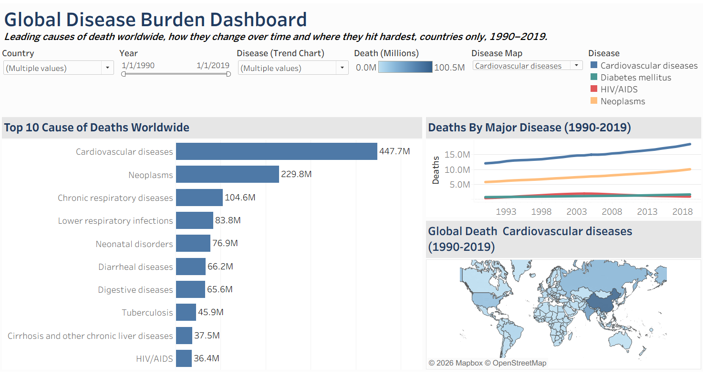
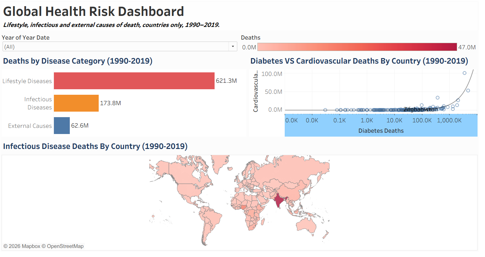
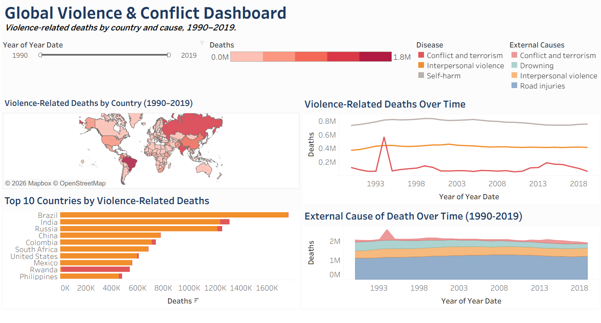

# Global Mortality Analysis (1990–2019)

An interactive Tableau analysis of annual deaths by cause across countries, built as three linked dashboards. It shows which causes of death dominate worldwide, how lifestyle diseases compare with infectious diseases, and where violence-related deaths are concentrated.

**Project type:** Business Analyst course project (CoachX, Batch CX-134)
**Tool:** Tableau Desktop

## Business Questions

1. Which causes of death account for the most deaths worldwide, and how have they changed since 1990?
2. How do lifestyle diseases compare with infectious diseases and external causes?
3. Where are violence-related deaths concentrated, and what drives them?

## Dashboards

### 1. Global Disease Burden
Top 10 causes of death, a multi-disease trend over time, and a world map controlled by a disease selector.



### 2. Global Health Risk
Deaths by category (Lifestyle, Infectious, External), a diabetes vs cardiovascular comparison by country, and an infectious disease map.



### 3. Global Violence and Conflict
Violence deaths by country, a trend of conflict, interpersonal violence and self-harm, a Top 10 country ranking, and external causes over time.



## Key Insights

- **Cardiovascular diseases are the leading cause of death**, at about 447.7M deaths over the period, nearly double neoplasms (229.8M).
- **Lifestyle diseases cause about 3.6 times as many deaths as infectious diseases** (621.3M vs 173.8M), roughly 72% of deaths across the three categories.
- **Diabetes and cardiovascular deaths rise together** across countries, which supports combined screening and prevention.
- **Infectious disease deaths are concentrated**, with India far above every other country.
- **Interpersonal violence drives most violence deaths.** Brazil, India and Russia lead the country ranking.
- **Conflict deaths spike sharply in 1994** (Rwanda), showing how one event can change a long-term trend.
- **Road injuries cause far more deaths than violence** among external causes.

## Recommendations

1. Prioritise cardiovascular prevention and screening, since it is the single largest cause of death.
2. Focus infectious disease programmes on the few high-burden countries.
3. Treat interpersonal violence as a public health issue in the top-ranked countries.
4. Put road safety alongside violence in external-cause budgets.
5. Build early-warning monitoring for conflict, because deaths can multiply in a single year.

## Methodology

- **Data:** annual number of deaths by cause, by country and year, 1990–2019.
- **Cleaning:** an `Is Country` calculated field removes regional and world aggregates so deaths are not double-counted. It is applied as a shared filter on every sheet.
- **Grouping:** causes are grouped into Lifestyle, Infectious and External categories with a calculated field.
- **Techniques:** parameters, calculated fields, context filters, dashboard filter actions, dual-use colour legends, log-scale scatter plot and filled maps.
- **Scope:** 10 worksheets and 3 dashboards.

## Limitations

- Figures are **absolute deaths, not rates per 100,000 people**, so populous countries rank high partly because of population size.
- Totals add up 30 years, so they mix long-term trends with one-off events.
- Category groupings are analyst-defined, and the data ends in 2019.
- The country ranking in Dashboard 3 covers conflict and interpersonal violence only, not self-harm.

## Repository Contents

```
Global-Mortality-Analysis/
├── Global_Mortality_Analysis.twbx                 # Tableau packaged workbook (data included)
├── Global_Mortality_Analysis_Insight_Report.pdf   # Full written insight report
├── images/                                        # Dashboard screenshots
└── README.md
```

## How to Open

1. Download `Global_Mortality_Analysis.twbx`.
2. Open it in Tableau Desktop or Tableau Public. The data is bundled inside the file.

## Author

**Kaif Kadar Sayyed**
Aspiring Business Analyst and Data Analyst
[LinkedIn](https://www.linkedin.com/in/kaifsayyed7) | [GitHub](https://github.com/Kaif4693)
